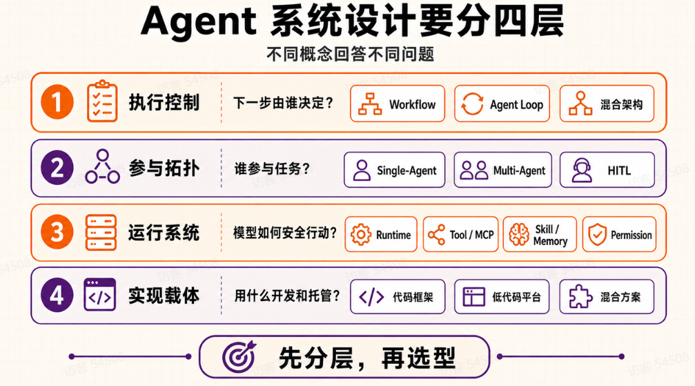
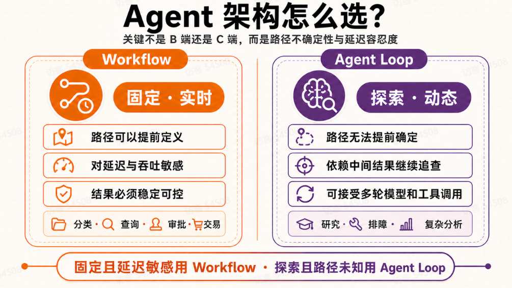
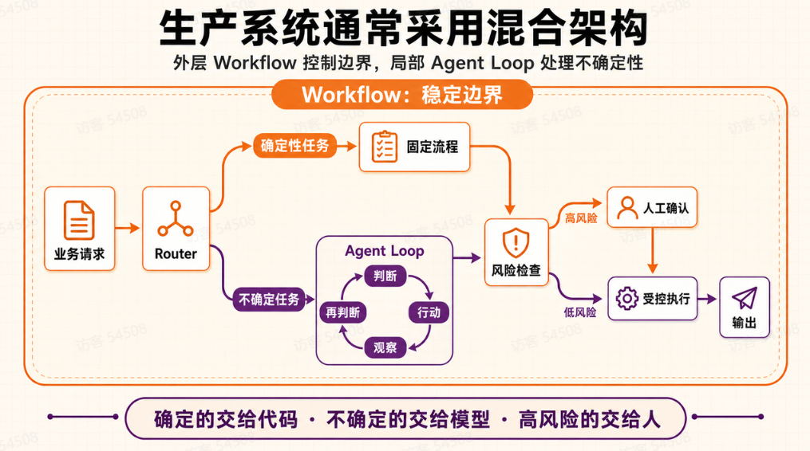
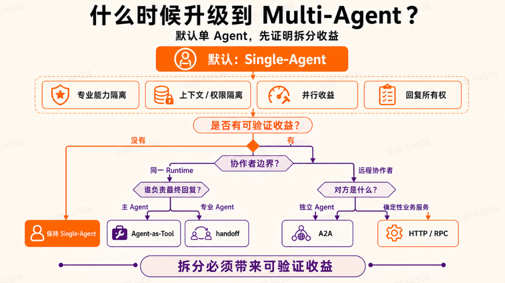
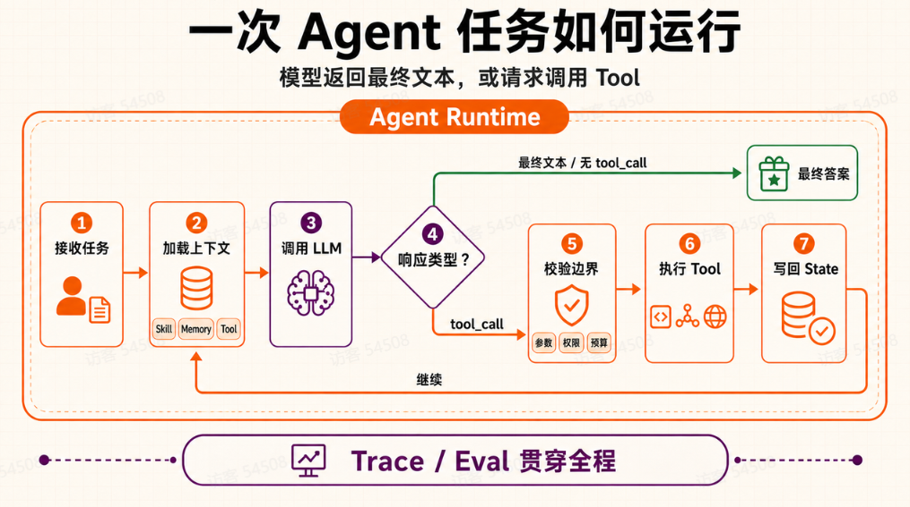
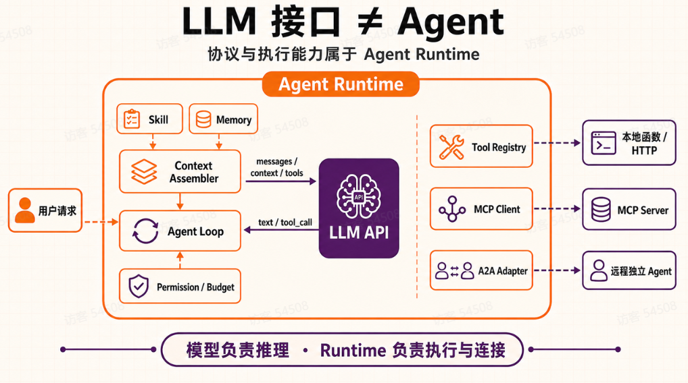
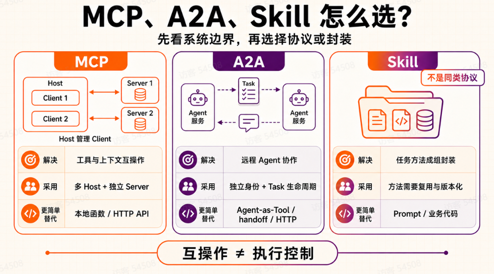

# Agent 架构设计

> 参考引用: https://my.feishu.cn/wiki/K3dAwR5qTiDNYikpQl9c2o01n5y



| 层级 | 核心问题 | 典型选择 |
| --- | --- | --- |
| 执行控制层 | 下一步由代码还是模型决定 | Workflow、Agent Loop、混合架构 |
| 参与拓扑层 | 谁参与，谁拥有最终回复 | Single-Agent、Multi-Agent、HITL |
| 运行系统层 | 多步任务怎样安全、持续、可恢复地运行 | Agent Runtime / Harness |
| 实现载体层 | 上面的能力用什么实现 | 代码框架、低代码平台、混合方案 |

## 一、执行控制层：Workflow、Agent Loop 与混合架构

执行控制层先看一个问题：上一步执行完以后，下一步由代码决定，还是由模型决定？

### Workflow 和 Agent Loop

Workflow 的步骤、分支和结束条件都提前写在代码里。模型可以负责分类、抽取或生成内容，但不能临时换一条流程。

Agent Loop 只固定`调用模型 -> 执行工具 -> 把结果再交给模型`这个循环。模型根据中间结果选择下一步，Runtime 负责执行工具并限制最大步数、超时和预算。



这几个名称说的是任务怎么处理：

| 模式 | 简单理解 |
| --- | --- |
| ReAct | 模型边判断边行动：选择一个工具，看到执行结果后，再决定下一步 |
| Plan-and-Execute | 先生成计划，再逐步执行；执行中也可以检查计划是否需要调整 |
| Reflection | 模型回看已经生成的结果，找出问题，再做一次修正 |
| Evaluator-Optimizer | 先生成结果，再按一组标准评价，根据评价继续修改，直到达到要求或触发结束条件 |

这些模式既可以放进 Workflow，也可以放进 Agent Loop。区别仍然要看下一步由代码固定，还是由模型根据结果决定。

### 怎么选

| 选择 | 下一步由谁决定 | 适合什么任务 | 需要注意 | 写操作怎么处理 |
| --- | --- | --- | --- | --- |
| Workflow | 代码提前写好步骤和分支 | 固定 RAG、分类路由、审批、交易等路径明确的任务 | 新场景通常需要改流程，但延迟、成本、测试和审计更容易控制 | 做好鉴权、幂等和审计后，由受控节点执行 |
| Agent Loop | 模型看完中间结果后再选 | 调研、故障诊断、代码分析等目标明确但路径未知的任务 | 限制工具、最大步数、Token / 费用、超时和重试；结果与延迟更难预测 | 不让模型执行付款、删除、发布等不可逆动作 |
| 混合架构 | 代码管外层流程，局部让模型探索 | 既有固定业务流程，又有少量无法提前写死的判断 | 写清 Loop 的入口、出口、状态和失败场景 | 探索只给建议，写入回到 Workflow 或人工审批 |

B 端和 C 端不是重点。先看路径能不能提前写出来，再看出错能不能撤销，以及接受多少延迟和成本。比如研究任务如果步骤固定，照样可以用 Workflow；企业内部的故障排除如果要一路追日志、监控和变更记录，就可能需要一个受限的 Agent Loop。

实际项目里经常把两种方式放在一起：外层 Workflow 管身份、预算、状态和写操作，里面只留一小段 Agent Loop 处理没法提前写死的判断。



## 二、参与拓扑层：Single-Agent、Multi-Agent 与 HITL

Multi-Agent 说的是有几个 Agent 参加、它们怎么分工。它和 Workflow、Agent Loop 不是一组概念。一个 Multi-Agent 系统里，每个 Agent 照样可以跑 Workflow、Agent Loop 或者两者的组合。Human-in-the-Loop (HITL) 也可以加在这些组合上面。

### 默认从 Single-Agent 开始

只要一组上下文、工具权限和输出要求能完成任务，就先用 Single-Agent。下面几种情况反复出现时，再考虑拆成 Multi-Agent：

- 不同步骤需要独立的工具、输出格式或评测集，放在一个 Agent 里经常发生规则冲突。
- 参与者不能共享数据、密钥或高风险工具。
- 子任务可以在输入固定后独立运行，而且实测节省的时间大于分发、汇总、重试和冲突处理的开销。
- 某个专业 Agent 必须接管后续对话，而不是只给主 Agent 返回一个结果。

如果只是把一个长 Prompt 拆成几个角色，没有得到上面的收益，就没必要拆。



### Agent 之间怎么调用

| 形态 | 控制与回复边界 | 何时使用 |
| --- | --- | --- |
| 同一 Runtime: Agent-as-Tool | 主 Agent 调用专业 Agent，保留上下文编排和最终回复 | 需要专业子结果，但主 Agent 仍负责综合 |
| 同一 Runtime: handoff | 当前分支交给专业 Agent，后者拥有后续回复 | 确实需要转交对话所有权 |
| 远程独立 Agent | 独立部署、身份或组织边界，拥有自己的 Runtime 和任务生命周期 | 需要发现、消息、状态和产物交换时评估 A2A |
| 普通 HTTP / RPC 服务 | 接口执行确定性业务能力，不拥有 Agent 任务语义 | 远程端只是查询、计算或写入服务时优先采用 |

HITL 表示人在哪一步参与：执行前审批、异常时接管，或结果出来后复核。人工确认不能替代程序鉴权，高风险动作还要最小权限、参数校验、幂等和审计。

Multi-Agent 会多出不少成本。路由、超时、重试和结果汇总都会增加延迟与 Token；多个 Agent 写同一份状态时，还要处理唯一写入者、幂等和并发合并。子 Agent 给错误结果，上游也可能继续放大，所以结果要保留来源和失败状态。评测不能只看最后答案，还要能定位是单个 Agent、路由、handoff 还是汇总出了问题。收益盖不过这些成本时，继续用 Single-Agent 或普通 Workflow。

## 三、运行系统层：Agent Runtime / Harness 与协议边界

### Agent Runtime 到底是什么

Agent Runtime 就是实际运行 Agent 的程序。模型给出判断以后，Runtime 还要把上下文、工具、状态、权限和结束条件串起来。一个能上线的 Runtime 至少要处理这些事情：

- 组装上下文、调用模型、注册和执行工具，并判断任务什么时候结束；
- 保存任务状态和 Checkpoint，支持暂停、继续、取消和服务重启后的恢复；
- 传递上下文，限制工具和数据权限，对敏感操作请求审批；
- 处理超时、重试、幂等、并发冲突、补偿和失败降级；
- 限制步骤、Token、费用和运行时间，避免循环失控；
- 记录模型调用、工具调用、状态变化、耗时、成本和错误，后面可以回放和评测。

一次任务大致这样运行：接受任务并组装上下文，调用模型，识别模型返回的文本或工具意图，校验并执行工具，把结果和状态写回，然后继续、暂停、恢复或结束。



Runtime 和 Harness 没有统一叫法。侠义的 Runtime 偏执行引擎；Harness 往往还包括 CLI / UI、文件系统、沙箱、审批和完整的任务生命周期。按广义理解，Harness 就是一套更完整的 Runtime。判断一个产品时，看它具体负责什么就行。

这些能力可以来自框架、低代码平台、应用代码，也可以组合使用。团队不用从零写一套，但业务授权、数据一致性和上线验收仍然要由自己的应用负责。

### 模型接口只负责什么



### MCP、A2A 与 Skill 的边界



### 在 Java / Spring 项目里是什么

在 Java 项目里，Agent Runtime 最后就是一组 Java 代码，但它通常不是某一个类或 Jar 包。一个具体的 Runtime 往往由 Spring Boot、Spring AI 或 ADK Java，再加上业务代码共同组成。

其中：

- Controller、信息消费者或定时任务负责接收请求和建立任务身份。
- AgentService 负责 Workflow / Loop、终止条件、预算和失败策略。
- Spring AI 的 `ChatClient` / `ChatModel` 或 ADK 的模型抽象负责模型调用。
- Tool Adapter 连接领域服务、本地函数、HTTP API 或 MCP Client。
- 数据库、缓存和队列承接任务状态、Checkpoint、并发控制与恢复。
- Spring Security、业务权限和审计组件负责限制最终写操作并记录审计日志。

用一段概念代码表示，大致是这样。它是说明各部分负责什么，不能直接当成某个框架的 API 使用。

```java
final class AgentRuntime {
  private static final int MAX_STEPS = 8;

  private final ModelClient model;
  private final ToolExecutor tools;
  private final PermissionGuard guard;
  private final ContextBuilder context;

  AgentResult run(AgentState state) {
    for (int step = 0; step < MAX_STEPS; step++) {
      ModelReply reply = model.call(context.from(state));
      state.append(reply);

      if (reply.toolCalls().isEmpty()) {
        return AgentResult.completed(reply.text(), state.trace());
      }

      for (ToolCall call : reply.toolCalls()) {
        guard.check(state.actor(), call);
        ToolResult result = tools.execute(call);
        state.appendToolResult(call, result);
      }

      state.checkpoint();
    }

    throw new StepLimitExceeded(MAX_STEPS);
  }
}
```

这段代码主要看这个过程：模型调用 -> 检测 `tool_call` -> 权限校验 -> 执行 -> 结果写回 -> 再次判断。

`MAX_STEPS` 用来防止无限循环，真实项目还要处理超时、重试、取消、幂等、并发冲突和人工审批。

`ChatClient` 或 `ChatModel` 单独只是模型调用入口，不是 Agent Runtime。有些框架把循环封装在内部，因此业务代码看不到 `for`；但状态、权限、预算、恢复和观测责任并没有消失。
