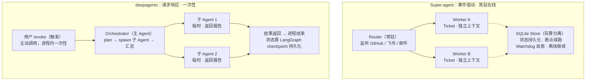

# Super-agent 的 Router/Worker 架构 vs deepagents 的 Orchestrator 架构：本质区别

> 本文回答一个核心问题：Super-agent 的 Router/Worker 架构，和 deepagents 的 orchestrator（主 Agent + 子 Agent）架构，本质上有什么区别？

---

## 一句话结论

**Router/Worker 是"常驻在线、事件驱动、由环境触发"的协作系统架构；deepagents 的 orchestrator 是"请求-响应、由调用方触发、进程内一次性展开"的任务分解架构。**

前者是"一个常开的管家 + 一群随时待命的员工"，后者是"每次叫一次、当场拆分任务干完就散的一次性项目组"。

---

## 机制对比图

---

## 本质区别：五个维度

### 1. 谁触发：环境事件 vs 调用方请求

- **Router/Worker** 是**事件驱动**的。Router 常驻运行，持续监听 GitHub issue、飞书群聊、邮件、CI 结果等外部事件——**没人 @ 它也会主动介入**（比如发现群里在讨论一个 bug，它会在后台复现并尝试修复）。触发源是"环境里发生了什么事"。
- **deepagents orchestrator** 是**请求-响应**的。必须有人（或某个程序）调用 `agent.invoke(...)`，它才开始工作。触发源是"谁调了我一次"。没有调用，它就什么也不做。

### 2. 生命周期：常驻 vs 一次性

- **Router/Worker** 是**常驻在线**的。Router 永远在运行；Worker 即使某个任务结束，系统还在，随时准备接下一个事件。配合存算分离（SQLite 存状态），电脑离线任务也能继续。
- **deepagents orchestrator** 是**一次性**的。一次 `invoke` 启动 → 拆任务 → spawn 子 Agent → 汇总 → 返回结果 → 进程结束。下次要干活，得重新调用、重新构建上下文。

### 3. "子代理"的定位：长期雇员 vs 临时工

这是最容易混淆、也最关键的一点。两者都有"子代理"，但性质完全不同：

- **Super-agent 的 Worker** 是**长生命周期的实体**，对应一个持久的 Ticket，有独立的 Session 和独立目录，能订阅后续消息、能从中断中恢复。它像"一个被雇了就一直待命的员工"。
- **deepagents 的子 Agent** 是**临时的（ephemeral）**，任务干完就销毁，只返回一份最终报告给主 Agent。它像"临时拉来干一次活就散的外包"。

### 4. 状态归属：系统内置 vs 外部可选

- **Super-agent** 把状态持久化**内置在架构里**（存算分离是核心设计原则，SQLite 是"脑手分离"的一等公民）。
- **deepagents** 的持久化是**靠 LangGraph 的 checkpoint/Store 后端**这个"可选配置"实现的，框架本身默认是内存态、无状态。

### 5. 目标：解放"注意力" vs 完成"单个任务"

- **Super-agent** 解决的核心矛盾是"人类注意力瓶颈"——一个人只能同时跟进 3~5 个会话，所以它要把**多任务调度和上下文管理从人手里上移到系统**，人只管定目标和验收。
- **deepagents orchestrator** 解决的是"**一个复杂任务怎么分解和执行**"——规划、文件操作、子任务委派、记忆，让单个 Agent 把一件长任务干好。

---

## 一句话收束

> **Super-agent 是在设计"一个团队如何持续运转"；deepagents 是在设计"一个项目经理如何把一件事干完"。**

Router/Worker 是"操作系统/调度器"层面的思考（进程、事件、存算分离、看门狗这些经典计算机系统思想的迁移）；deepagents orchestrator 是"应用框架"层面的思考（任务规划、工具编排、上下文管理）。

所以它们不仅不冲突，反而是**不同层**——这也是为什么更务实的组合是：**用 deepagents 做 Worker 的执行内核，外面套一层 Router 来复刻 Super-agent 的调度**。
