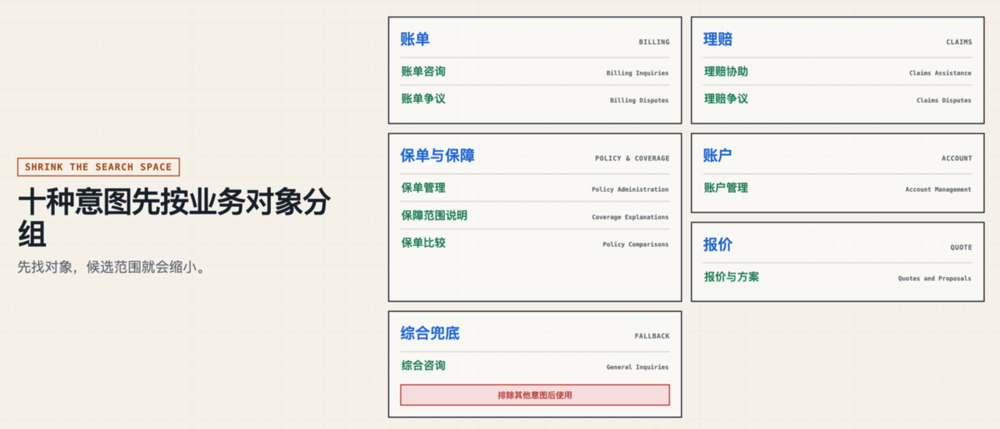

# 如何评测意图识别的效果01

## 一、单分类指标的评估

我们评价一个 Agent 系统好不好，大家最先想到的就是看这个问题到底有没有被 Agent 正确回答。大家会通过人工分辨或者引入 LLM 进行评估。

但是业内像 LangChain、Anthropic 会有比较标准的评价指标。今天就跟大家分享一下。

前置条件：
单标签多分类：以我们之前的意图识别分类器评估为例。这里假设每个用户问题值对应一个分类。如果原始问题同时包含多个意图，先把它拆成多个单意图问题，再按照“一个问题对应一个分类”来评测。

以保险这个业务场景下有十个意图为例。



假设我们特别关注：Claims Disputes（理赔争议）这个意图分类

### 1.1 四种判断结果

| 类别                       | 实际情况 | 模型推测   | 中文理解 |
| -------------------------- | -------- | ---------- | -------- |
| TP（实际是，推测也是）     | 实际是   | 推测也是   | 正确识别 |
| FP（实际不是，却推测是）   | 实际不是 | 却推测是   | 错误识别 |
| FN（实际是，却推测不是）   | 实际是   | 却推测不是 | 漏掉     |
| TN（实际不是，推测也不是） | 实际不是 | 推测也不是 | 正确排除 |

记住两个规则：

- `Positive / Negative`：模型推测“是”还是“不是”
- `True / False`：不是指的实际情况是还是不是。模型的推测和真实情况相比是“正确”还是“错误”。

#### 一个完整例子：用 5 个用户问题评估一个目标类别

评估一个类别，并不意味着 5 条问题都必须是“理赔争议”。要计算 TP（实际是，推测也是）、FP（实际不是，却推测是）、FN（实际是，却推测不是）和 TN（实际不是，推测也不是），样本中既要有目标类别的正例，也要有其他类别的反例。这里把其他九个意图统一视为“非理赔争议”，只评估模型识别“理赔争议”的效果。

下面用同一批 5 个用户问题，贯穿 Accuracy、Precision、Recall 和 F1 的计算：

| 编号 | 用户问题                                             | 人工标注   | 模型输出   | 结果                       |
| ---- | ---------------------------------------------------- | ---------- | ---------- | -------------------------- |
| 1    | 保险公司只赔了一半，我不同意这个结果，要求重新核定。 | 理赔争议   | 理赔争议   | TP（实际是，推测也是）     |
| 2    | 我的住院理赔被拒了，我要申诉。                       | 理赔争议   | 理赔争议   | TP（实际是，推测也是）     |
| 3    | 这次定损金额明显太低，麻烦重新审核。                 | 理赔争议   | 非理赔争议 | FN（实际是，却推测不是）   |
| 4    | 我的理赔申请三天了，为什么还没到账？                 | 非理赔争议 | 理赔争议   | FP（实际不是，却推测是）   |
| 5    | 申请理赔需要准备哪些材料？                           | 非理赔争议 | 非理赔争议 | TN（实际不是，推测也不是） |

统计结果：

```
TP (实际是，推测也是) = 2
FP (实际不是，却推测是) = 1
FN (实际是，却推测不是) = 1
TN (实际不是，推测也不是) = 1
总样本数 = 5
```

这张表里，第 3 条是漏报：用户已经表达了明确异议，但模型没有识别出来。第 4 条是误报：用户只是在询问到账进度，模型却把它升级成了争议。

### 1.2 最基本指标：Accuracy

计算公式：

```
Accuracy = 分类正确数量 ÷ 总数
分类正确数量 = TP（实际是，推测也是）+ TN（实际不是，推测也不是）
// TP（实际是，推测也是）和 TN（实际不是，推测也不是）都表示模型判断正确，因此都计入正确数量。
```

代入上面 5 条数据：

```
分类正确 = TP（实际是，推测也是）+ TN（实际不是，推测也不是）
= 2 + 1 = 3
用户问题总数 = 5

Accuracy = 3 ÷ 5 = 60%
```

这里的 60% 表示：5 个用户问题中，有 3 个被正确分类。它把“正确识别争议”和“正确排除非争议”都算作答对。

> Accuracy 告诉我们整体答对多少，但不能说明某个重要类别表现如何。

### 1.3 Precision：模型的判断有多可信

计算公式：

```
Precision = 正确预测为争议的数量 ÷ 所有被模型预测为争议的数量
Precision = TP（实际是，推测也是）÷ [TP（实际是，推测也是）+ FP（实际不是，却推测是）]
```

代入数据：

```
Precision = 2 ÷ 3 ≈ 66.7%
```

含义：

> 模型每预测 3 条理赔争议，其中大约有 2 条是真的。

Precision 低，会产生很多误报，把普通咨询错误升级为争议。

Accuracy 会计算 TN（实际不是，推测也不是），Precision 不看 TN（实际不是，推测也不是）。因此，当非目标类别很多时，Accuracy 可能看起来很高，但模型对目标类别的判断不一定可靠。

### 1.4 Recall：真正的争议找回了多少

计算公式：

```
Recall = 正确预测为争议的数量 ÷ 实际争议的总数量
Recall = TP（实际是，推测也是）÷ [TP（实际是，推测也是）+ FN（实际是，却推测不是）]
```

代入数据：

```
Recall = 2 ÷ 3 ≈ 66.7%
```

含义：

> 实际存在 3 条理赔争议，模型找到了其中 2 条。

Recall 低，会漏掉真正需要处理的争议。

#### Precision 和 Recall 的区别

> Precision：你抓出来的这些，抓的准不准？
> Recall：所有应该抓的，你抓全了没有？

不同业务对它们的要求不同：

#### 例子一：内容推荐为什么更关心 Precision

假设首页只能推荐 5 篇文章。

方案 A 推荐的 5 篇文章中，用户喜欢 4 篇：

```
Precision = 4 ÷ 5 = 80%
```

方案 B 推荐的 5 篇文章中，用户只喜欢 1 篇：

```
Precision = 1 ÷ 5 = 20%
```

用户打开首页，只会看到这 5 篇。

因此推荐错误的直接后果是：

- 用户觉得内容不相关；
- 频繁跳过；
- 逐渐不愿意使用产品。

世界上可能还有 100 篇用户会喜欢的文章，但首页不可能全部展示。漏掉其中一些，通常没有推荐一堆垃圾内容那么糟糕。

所以推荐场景经常关注：

```
给出的有限推荐是否足够准确
```

这更接近 Precision。

严格来说，推荐系统常使用 `Precision@K`：

```
Precision@5
= 推荐的前 5 个内容中
  用户真正喜欢的比例
```

#### 例子二：安全告警为什么更关注 Recall

假设公司一天发生 10 次真实入侵。

系统只报警 4 次：

```
Recall = 4 ÷ 10 = 40%
```

虽然这 4 次报警都是真的，但另外 6 次入侵没有被发现。

攻击者可能已经：

- 窃取数据；
- 获取管理员权限；
- 在系统中植入后门。

因此安全系统经常需要尽量发现所有可疑行为。

不过，如果每天产生 10 万条误报，安全团队会陷入“告警疲劳”，最终可能忽略真正的攻击。

所以实际目标通常是：

```
先保证关键攻击有较高 Recall
再通过规则、聚合和二次模型减少误报
```

### 1.5 Fβ 调和平均数：综合 Precision 和 Recall

普通 F1 默认：

```
Precision 和 Recall 同样重要
```

如果 Recall 更重要，可以使用 `F2`：

```
F2 更重视 Recall
```

如果 Precision 更重要，可以使用 `F0.5`：

```
F0.5 更重视 Precision
```

统称为 `Fβ`：

```
Fβ = (1 + β²) × Precision × Recall
     -----------------------------
        β² × Precision + Recall
```

- `β = 1`：Precision 和 Recall 同等重要，也就是 F1；
- `β > 1`：更重视 Recall；
- `β < 1`：更重视 Precision。

F1 用于综合衡量两者：

```
F1 = 2 × Precision × Recall
    ------------------------
      Precision + Recall
```

代入：

```
Precision = 0.667
Recall = 0.667

F1 ≈ 0.667
```

也就是约 66.7%。

只有 Precision 和 Recall 都比较高，F1 才会高。

例如：

| Precision | Recall | F1 大致表现  |
| --------- | ------ | ------------ |
| 95%       | 20%    | 低，漏报严重 |
| 30%       | 95%    | 低，误报严重 |
| 85%       | 85%    | 高，比较均衡 |

#### 为什么不用普通平均数

如果直接计算算术平均：

```
(Precision + Recall) / 2
```

那么一个指标特别高，可能会掩盖另一个指标特别低。

例如：

```
Precision = 100%
Recall = 10%
```

算术平均是：

```
(1.0 + 0.1) / 2 = 55%
```

看起来还有 55 分。

但 F1 是：

```
F1 = 2 × 1.0 × 0.1 / (1.0 + 0.1)
   ≈ 18.2%
```

F1 会更接近较低的 Recall，明确暴露模型严重偏科。

因此 F1 使用的是调和平均，它的特点是：

> 只有 Precision 和 Recall 都不错，F1 才会高。

## 二、正确使用方式

不要这样：

```
模型 F1 最高
-> 直接上线
```

### 评估流程

```
第一步：检查业务硬性要求

自动拒绝：
Precision 是否达到最低要求？

风险初筛：
Recall 是否达到最低要求？

第二步：满足硬性要求的模型中
再用 F1 比较整体平衡。

第三步：
查看具体错例。
```

所以最终答案是：

> Precision 和 Recall 完全可以、也应该分别看；F1 只是把两者压缩成一个方便比较的数字。业务决策看 Precision 和 Recall，模型排序和方案比较可以辅助看 F1。
