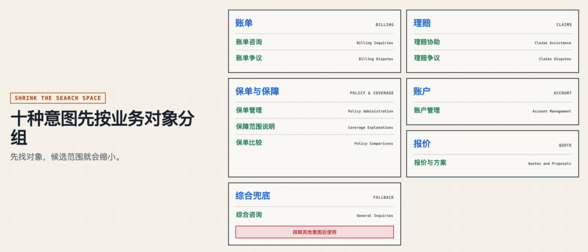

# 如何评测意图识别的效果02

## 一、多意图指标

还是以我们第一节课提到的保险这个业务场景下有十个意图为例。



### 1.1 混淆矩阵

混淆矩阵展示：

> 实际类别是什么，模型最终预测成了什么。

- 行：实际类别
- 列：模型预测类别
- 对角线：预测正确
- 非对角线：预测错误

| 实际↓ / 预测→ | 理赔争议 | 理赔协助 | 账单争议 | 账单咨询 |
| ------------- | -------- | -------- | -------- | -------- |
| 理赔争议      | 4        | 0        | 1        | 0        |
| 理赔协助      | 1        | 4        | 0        | 0        |
| 账单争议      | 0        | 0        | 3        | 2        |
| 账单咨询      | 0        | 0        | 1        | 4        |

对角线正确数：

```
4 + 4 + 3 + 4 = 15
```

非对角线错误数：

```
1 + 1 + 2 + 1 = 5
```

最大错误簇：

```
实际：账单争议
预测：账单咨询
数量：2
```

说明模型容易混淆：

- 询问收费原因
- 认为收费错误并要求纠正

使用混淆矩阵时：

1. 找到非对角线最大的错误格。
2. 判断错误方向和业务成本。
3. 查看该格对应的原始问题。
4. 修改类别定义和边界案例。
5. 补充 Prompt 或 RAG 对比样本。
6. 将错误样本加入回归测试。
7. 修改后重新计算所有指标。

建议查看：

- 原始数量：判断错误规模
- 按行归一化：观察 Recall 和漏识别方向
- 按列归一化：观察 Precision 和误报来源

### 1.2 Micro 次数维度，看整体

Micro：整体做得怎么样，高频类别影响更大。按次算。
Macro：每个类别做得怎么样，所有类别权重相同。按类算。

#### 1.2.1 Micro-Precision

Micro-Precision 让每一次预测拥有相同权重；

先汇总所有类别的 TP 和 FP，再计算 Precision：

```
Micro-Precision
= ΣTPᵢ ÷ (ΣTPᵢ + ΣFPᵢ)
```

它回答：

> 从所有模型预测结果来看，整体有多少是正确的？

举例

```
ΣTP = 15
ΣFP = 5

Micro-Precision
= 15 ÷ (15 + 5)
= 75%
```

最佳实践

适合判断整体预测结果的可信程度。

但在单标签多分类中，它通常等于 Accuracy，不能反映具体哪个类别误报严重。

#### 1.2.2 Micro-Recall

先汇总所有类别的 TP 和 FN，再计算 Recall：

```
Micro-Recall
= ΣTPᵢ ÷ (ΣTPᵢ + ΣFNᵢ)
```

它回答：

> 从所有实际存在的正确标签来看，模型整体找回了多少？

举例

```
ΣTP = 15
ΣFN = 5

Micro-Recall
= 15 ÷ (15 + 5)
= 75%
```

最佳实践

适合观察整体漏识别情况。

但在单标签多分类中，每一个分类错误都会同时产生一个 FP 和一个 FN，因此：

```
Micro-Precision
= Micro-Recall
= Accuracy
```

如果关心某个重要类别是否被漏掉，应该查看该类别自己的 Recall。

#### 1.2.3 Micro-F1

Micro-F1 平衡 Micro-Precision 和 Micro-Recall：

```
Micro-F1
= 2 × Micro-Precision × Micro-Recall
  ÷
  (Micro-Precision + Micro-Recall)
```

它回答：

> 把所有问题放在一起看，系统整体分类表现怎么样？

举例

```
Micro-Precision = 75%
Micro-Recall = 75%

Micro-F1
= 2 × 0.75 × 0.75 ÷ (0.75 + 0.75)
= 75%
```

当前是单标签多分类，所以：

```
Micro-F1 = Accuracy = 75%
```

最佳实践

适合：

- 衡量整体流量效果
- 比较模型或 Prompt 版本
- 设置发布门槛
- 监控线上整体质量

但大类别对 Micro-F1 的影响更大，可能掩盖小类别的问题。

#### 1.2.4 Micro-Fβ

概念

Micro-Fβ 可以调整 Precision 和 Recall 的重要程度：

```
Micro-Fβ
= (1 + β²) × Micro-Precision × Micro-Recall
  ÷
  (β² × Micro-Precision + Micro-Recall)
```

- `β = 1`：同等重视 Precision 和 Recall
- `β > 1`：更加重视 Recall
- `β < 1`：更加重视 Precision

举例

假设：

```
Micro-Precision = 80%
Micro-Recall = 50%
```

则：

```
Micro-F1 = 61.5%
Micro-F2 = 54.1%
Micro-F0.5 = 71.4%
```

由于 Recall 较低，所以更重视 Recall 的 Micro-F2 会给出更严格的分数。
但在当前案例中：

```
Micro-Precision = Micro-Recall = 75%
```

因此：

```
Micro-F0.5
= Micro-F1
= Micro-F2
= 75%
```

最佳实践
Micro-Fβ 更适合：

- 多标签分类
- Micro-Precision 和 Micro-Recall 不相等
- 整体误报与漏报成本不同

标准单标签多分类中，Micro-Fβ 通常没有太多额外价值。

### 1.3 Macro 分类维度，看分类

```
注意：这里的指标用的是通用的平均数，也容易出现单个分类得分很低的时候，容易忽略的情况。
可以用 Macro 的调和平均算法来做。

H-Mean(Class-F1) 可选预警 =  K ÷ Σ(1 ÷ F1ᵢ)
```

#### 1.3.1 Macro-Precision

概念

先计算每个类别自己的 Precision，再取平均：

```
Macro-Precision
= (P₁ + P₂ + … + Pₖ) ÷ K
```

它回答：

> 平均来看，每个类别的预测结果有多可信？

每个类别拥有相同权重。

举例

| 类别     | Precision |
| -------- | --------- |
| 理赔争议 | 80%       |
| 理赔协助 | 100%      |
| 账单争议 | 60%       |
| 账单咨询 | 66.70%    |

```
Macro-Precision
= (80% + 100% + 60% + 66.7%) ÷ 4
= 76.7%
```

最佳实践

适合检查是否有某些类别误报严重。

但平均数仍然可能掩盖单个差类别，所以还要查看各类别 Precision。

#### 1.3.2 Macro-Recall

概念

先计算每个类别自己的 Recall，再取平均：

```
Macro-Recall
= (R₁ + R₂ + … + Rₖ) ÷ K
```

它回答：

> 平均来看，每个类别实际存在的问题被找回了多少？

举例

| 类别     | Recall |
| -------- | ------ |
| 理赔争议 | 80%    |
| 理赔协助 | 80%    |
| 账单争议 | 60%    |
| 账单咨询 | 80%    |

```
Macro-Recall
= (80% + 80% + 60% + 80%) ÷ 4
= 75%
```

账单争议 Recall 只有 60%，说明真实的账单争议被漏掉了 40%。

最佳实践

Macro-Recall 适合：

- 检查各类别整体漏识别情况
- 类别数量不均衡的任务
- 每个类别都不能被忽略的场景

在单标签多分类中，Macro-Recall 也常被称为“平衡准确率”。

#### 1.3.3 Macro-F1

概念

先计算每个类别自己的 F1，再进行平均：

```
Macro-F1
= (F1₁ + F1₂ + … + F1ₖ) ÷ K
```

它回答：

> 每个类别的 Precision 和 Recall 综合表现是否均衡？

举例

| 类别     | Precision | Recall | F1     |
| -------- | --------- | ------ | ------ |
| 理赔争议 | 80%       | 80%    | 80.00% |
| 理赔协助 | 100%      | 80%    | 88.90% |
| 账单争议 | 60%       | 60%    | 60.00% |
| 账单咨询 | 66.70%    | 80%    | 72.70% |

```
Macro-F1
= (80.0% + 88.9% + 60.0% + 72.7%) ÷ 4
= 75.4%
```

最佳实践

Macro-F1 适合：

- 检查小类别是否被忽略
- 判断各类别是否均衡
- 类别样本数量差距较大的任务
- 防止模型只优化高频类别

注意：

```
Macro-F1
= 各类别 F1 的平均
```

通常不等于：

```
用 Macro-Precision 和 Macro-Recall 再计算一次 F1
```

### 一轮评测，怎么从指标异常走到具体修复？

```
假设上线门槛
Micro-F1 >= 80%
每类 F1 >= 70%

整体结果
Micro-F1 = 75%
未通过

类别汇总
Macro-F1 = 75.4%
H-Mean = 73.8%

最低类别
账单争议 F1 = 60%
```

#### 1. 先定业务门槛

在评测前确定整体门槛和重要类别门槛，避免看到结果后再临时调整标准。

#### 2. 看 Micro 判断整体

Micro-F1 只有 75%，低于 80% 的上线门槛，说明整体效果还不能直接发布。

#### 3. 看 Macro 与最低类别

Macro-F1、H-Mean 和 Min-Class-F1 一起看，发现“账单争议”只有 60%。

#### 4. 看该类 Precision / Recall

账单争议 P=60%、R=60%；既有其他类别误报进来，也有真实账单争议被漏掉。

#### 5. 看混淆矩阵和错例

最大方向是“账单争议 -> 账单咨询” 2 条，说明模型没有稳定区分“询问”与“要求纠正”。

#### 6. 修复后做回归

收紧类别定义、补充对比示例，把错例加入回归集，然后重新计算全部指标。

#### 整体指标发现异常 -> 类别指标找到短板 -> Precision / Recall 判断误报或漏报 -> 混淆矩阵定位方向 -> 错例驱动修复 -> 回归验证
