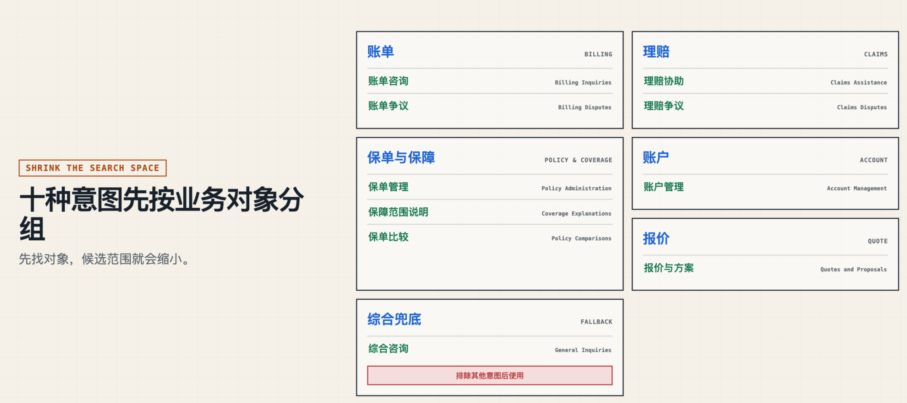
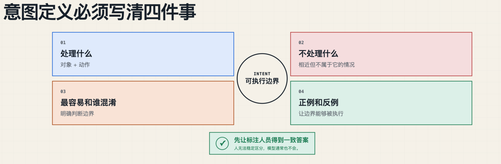
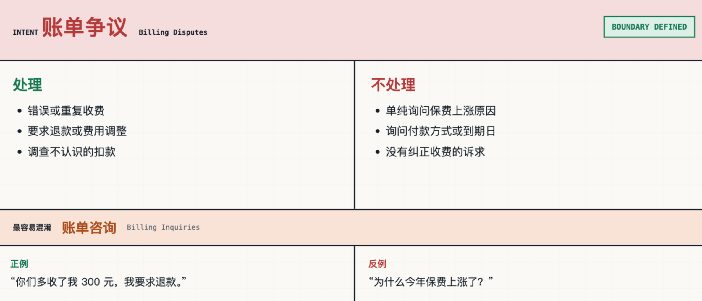

# 理解 “意图识别”

## 一、什么是意图识别

意图识别，就是判断用户这句话想解决什么问题、推动什么事情，并把它归入系统预先定义的类别。

用户的一句话里面可能有一个或多个意图。
意图识别不是从句子里面抓一个关键词，而是需要先看用户谈的业务对象，再看他想推动什么动作。
（对象 + 动作 = 意图）

## 二、举个例子

举一个保险业务场景的例子。假设这个场景下定义了十种意图。

### 2.1 保险场景下的意图定义



| 业务大类   | 意图（英文标签）      | 中文名称       | 典型问题                                                 |
| ---------- | --------------------- | -------------- | -------------------------------------------------------- |
| 费用与账务 | Billing Inquiries     | 账单咨询       | 保费金额、账单明细、付款方式、缴费日期                   |
| 费用与账务 | Billing Disputes      | 账单争议       | 错误收费、意外扣费、退款、保费调整、滞纳金               |
| 保单服务   | Policy Administration | 保单管理       | 修改、更新、取消、续保、复效、增减保障                   |
| 保单服务   | Coverage Explanations | 保障范围说明   | 承保范围、责任限额、免责条款、免赔额、自付费用           |
| 保单服务   | Policy Comparisons    | 保单比较       | 比较不同保单、保障档位或其他公司的产品                   |
| 理赔服务   | Claims Assistance     | 理赔协助       | 理赔流程、材料提交、理赔进度、赔款时间                   |
| 理赔服务   | Claims Disputes       | 理赔争议       | 拒赔、少赔、重新审核、理赔申诉                           |
| 售前咨询   | Quotes and Proposals  | 报价与投保方案 | 新保单报价、价格比较、折扣、组合购买、转保               |
| 账户服务   | Account Management    | 账户管理       | 登录、重置密码、在线账户功能、个人资料更新               |
| 综合服务   | General Inquires      | 一般咨询       | 联系方式、营业时间、一般产品信息、无法归入其他类别的问题 |

具体定义几个意图取决于你们自己的业务场景下有几个需要被后续流程处理的意图，理论上来说定义意图的数量可以是无限多，一些不需要处理的意图都可以归类到综合兜底这个意图里面。

### 2.2 看两个保险场景下的例子

使用“对象 + 动作”的判断方式。

### 2.3.1 单意图

用户问题

> 我准备退休了，想重新调整寿险保障，使它更适合退休后的生活，应该怎么修改？

答案

```
对象：现有寿险保单
动作：修改保障方案
意图：保单管理
```

### 2.3.2 多意图

用户问题

> 我的车险续保账单多收了800元，请核实并退回多收的费用；同时帮我取消自动续保，并比较一下两个不同免额的方案哪个更适合我。

答案

```
对象1：续保账单中多收的费用
动作1：质疑收费并要求退款
意图1：账单争议

对象2：车险自动续保设置
动作2：要求取消自动续保
意图2：保单管理

对象3：两个不同免赔额的保险方案
动作3：比较并请求选择建议
意图3：保单比较
```

## 三、如何做意图定义说明卡

**考虑4个事情**

```
1. 处理什么
2. 不处理什么
3. 最容易和谁混淆
4. 正例和反例
```



**账单争议展示一张完整的意图说明卡**

先为每种意图写一张说明卡：处理什么、不处理什么、最容易和谁混淆，再补上正例和反例。

```
意图：账单争议

处理：
- 错误或重复收费
- 要求退款或费用调整
- 调查不认识的扣款

不处理：
- 单纯询问保费上涨原因
- 询问付款方式或到期日
- 没有纠正收费的诉求

最容易混淆：账单咨询
正例：“你们多收了我 300 元，我要求退款。”
反例：“为什么今年保费上涨了？”
```

这样的说明卡可以同时提供给模型、标注人员和评测人员。



## 四、用LLM做意图识别

### 4.1 LLM意图识别提示词

#### 4.1.1 zero-shot 70%

```python
def simple_classify(context):
    ticket = context['vars']['text']

    prompt = """
    你对客户支持工单进行分类，归入以下类别之一：

    <categories>
        {categories}
    </categories>

    <ticket>
        {ticket}
    </ticket>

    仅回复类别标签
    """

    return prompt
```

其中：

- `<categories>` 放系统允许使用的类别；
- `<ticket>` 放用户工单；
- `{ticket}` 是程序运行时替换进去的变量；
- 最后一行规定模型应该怎样返回结果。

{categories}：

```xml
<category>
    <label>理赔协助</label>
    <content>
        询问理赔流程
        协助提交理赔资料
        查询理赔进度
    </content>
</category>
```

这个提示词做了三件事：

1. 取得需要分类的工单。{ticket}
2. 把类别定义和工单一起放进 Prompt。{categories}
3. 要求模型只返回类别名称。例如：仅回复类别标签

模型每次收到请求时，根据 Prompt 中的类别定义临时完成判断，这通常为：Zero-shot Classification。
这里的“Zero-shot”表示没有给模型提供已经分类好的示例，但类别说明仍然是必要的。

#### 4.1.2 Few-shot 分类的 prompt 85%

{categories}

```xml
<category>
    <label>账单争议</label>

    <handles>
        错误或重复收费；
        要求退款或费用调整；
        调查不认识的扣款。
    </handles>

    <excludes>
        单纯询问保费上涨原因；
        询问付款方式或到期日；
        没有纠正收费诉求的账单问题。
    </excludes>

    <confused_with>账单咨询</confused_with>

    <positive_examples>
        <example>
            <query>你们多收了我 300 元，请退回来。</query>
            <label>账单争议</label>
        </example>
        <example>
            <query>信用卡上有一笔不认识的保险扣款，请帮我调查。</query>
            <label>账单争议</label>
        </example>
    </positive_examples>

    <negative_examples>
        <example>
            <query>为什么今年的保费比去年贵？</query>
            <label>账单咨询</label>
            <reason>用户只是询问上涨原因，没有要求纠正收费。</reason>
        </example>
    </negative_examples>
</category>
```

#### 4.1.3 带RAG例子的 prompt 90%

我们把用户的问题和对应的标签存进向量数据库。用户查询的时候先去向量数据库里面查询出跟这个问题最相似的问题对应的标签是什么。用户问题查询向量数据库，再让模型参考这些判例完成分类。

**什么是向量数据库？**

Embedding 模型会把文本转换成一组数字：

```
“理赔只赔了一半，我要申诉”
-> [0.12, -0.44, 0.08, ...]
```

这组数字叫做向量。

语义接近的句子，向量通常也更接近：

```
理赔金额不足，我要重新审核
赔付结果太低，我想申请复核
```

即使两句话没有使用完全相同的词，Embedding 也可能识别它们表达了相似的意思。
项目使用向量点积计算相似度，并把结果从高到低排序。实际系统也经常使用余弦相似度。

需要注意：

> 相似度高只表示文本语义接近，不代表类别一定相同

“我想知道理赔进度”和“我不接受理赔结果”都在讨论理赔，但动作不同，可能属于两个类别。

**为什么不把所有标准问法直接写进 Prompt**

少量标准问法当然可以直接放进 Prompt：

```xml
<example>
    <query>我的理赔资料已经提交，请问处理到哪一步了？</query>
    <label>Claims Assistance</label>
</example>
```

问题是，真实用户的表达方式无法列完。

同一个“少陪后要求复核”，可能被写成：

```
为什么只赔了一半？
定损结果不合理，我要申诉。
维修费没有全报，请重新检查。
这个赔付决定我不接受。
赔款和实际损失差太多了。
```

如果把所有历史问法都放进固定 Prompt，会出现：

- Prompt 越来越长；
- 调用成本和延迟上升；
- 大量无关案例干扰当前判断；
- 新案例加入后需要不断修改 Prompt；
- 上下文长度最终会达到上限。

固定 few-shot 更像是给“给所有问题发同一本案例册”；RAG 更像是“每来一个问题，只翻出最相关的几份判例”。

#### 4.1.4 加上引导词的 prompt 95%

我们
