# 销售业务智能体如何核实一次续费降价

## 1.业务背景：销售经理要复盘一笔续费

**2026 年 11 月 9 日 10:00**，李经理在销售业务智能体中输入：

> 查一下上个月张三给 A 客户做的企业协作平台年度续费报价，当月最后一次确认的金额是多少？为什么从 800 万降到 700 万？把相关会议和邮件也找出来。·

这家企业已经有四个存储与检索的数据库系统可以用于访问业务资料：

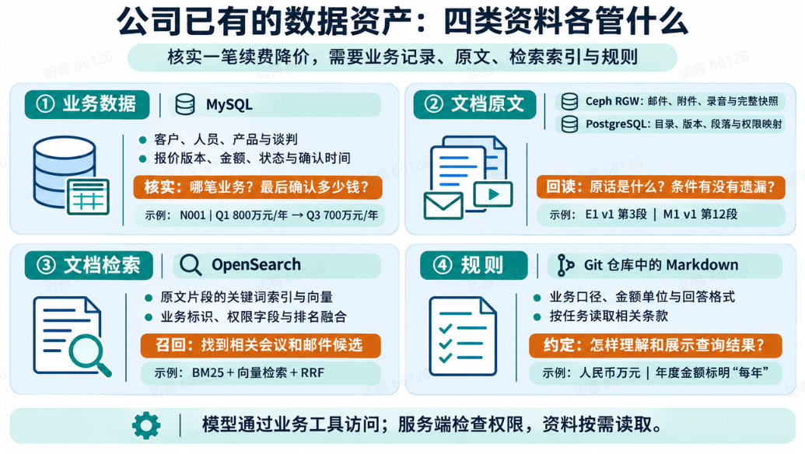

## 2.执行步骤

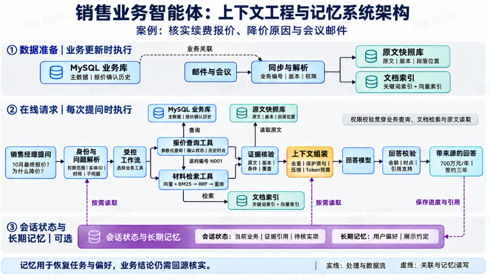

本次请求依次经过问题解析、MySQL报价核实、OpenSearch材料检索、原文段落回读与按需原件核验、上下文组装和回答校验。

### 2.1 第一步：大模型解析用户问题

> 查一下上个月张三给 A 客户做的企业协作平台年度续费报价，当月最后一次确认的金额是多少？为什么从 800 万降到 700 万？把相关会议和邮件也找出来。

```json
{
  "entities": {
    "customer_name": "A客户",
    "salesperson_name": "张三",
    "product_name": "企业协作平台"
  },
  "business_type": "annual_renewal",
  "time": {
    "expression": "上个月",
    "applies_to": "quote.confirmed_at"
  },
  "questions": ["q1", "q2", "q3", "q4", "q5"],
  "claims_to_verify": {
    "original_amount_cny": 8000000,
    "final_amount_cny": 7000000
  }
}
```

### 2.1.2 用户的问题拆成有依赖关系的问题集

```json
{
  "questions": [
    {
      "id": "q1",
      "question": "上个月，张三给A客户做的企业协作平台年度续费报价，最后一次确认的金额是什么？",
      "depends_on": []
    },
    {
      "id": "q2",
      "question": "同一轮谈判中，是否确实发生了年度报价从800万元调整到700万元的变化？",
      "depends_on": ["q1"]
    },
    {
      "id": "q3",
      "question": "如果确实发生降价，批准降价的原因和适用条件是什么？",
      "depends_on": ["q2"]
    },
    {
      "id": "q4",
      "question": "与本轮谈判有关的会议有哪些，相关内容位于哪里？",
      "depends_on": ["q1"]
    },
    {
      "id": "q5",
      "question": "与本轮谈判有关的邮件有哪些，相关内容位于哪里？",
      "depends_on": ["q1"]
    }
  ]
}
```

### 2.1.3 提到的人名和其他的名词，怎么映射到系统中的具体的ID？

| 对象             | ID             | 含义                               |
| ---------------- | -------------- | ---------------------------------- |
| 租户             | T001           | 当前公司                           |
| 当前访问者       | U900           | 李经理，由服务端登录会话确定       |
| 被查询的业务人员 | U003           | 张三，由人员目录解析               |
| 客户             | C001           | A客户                              |
| 产品             | P008           | 企业协作平台                       |
| 业务类型         | annual_renewal | 年度续费                           |
| 谈判             | N001           | 系统在本次查询范围内定位的续费谈判 |

这些对象和人名的映射关系一般也在公司的数据库里面维护着。大模型根据提取的名称，发起实体解析工具调用。

例如，用 `resolve_business_entities` 这个mcp工具

```json
{
  "name": "resolve_business_entities",
  "arguments": {
    "customer_name": "A客户",
    "salesperson_name": "张三",
    "product_name": "企业协作平台",
    "business_type": "annual_renewal"
  }
}
```

应用执行调用，工具背后的业务服务在当前租户和授权范围内查询对应目录，返回候选记录。

但是可能存在重名的情况，例如查到两个“张三”，系统继续核对：

- 谁负责 A 客户？
- 谁参与了该产品的年度续费？
- 在相关业务时点，人员与客户的归属关系是什么？

如果这些条件能唯一确定对象，就返回对应 ID；仍有多个候选时，请用户补充部门、工号或业务编号。没有匹配记录时，返回未找到。

解析成功后，后续查询才能使用：

```json
{
  "customer_id": "C001",
  "salesperson_id": "U003",
  "product_id": "P008",
  "business_type": "annual_renewal"
}
```

## 2.2 第二步：权限与安全审核

服务端确认李经理 U900 有权查看 N001 的完整报价版本历史；会议与邮件仍按各自权限检查。

## 2.3 第三步：根据问题依次调用不同的查询系统

应用将当前步骤需要的工具名称、用途、入参结构和必要的返回字段说明提供给模型。工具目录包括：

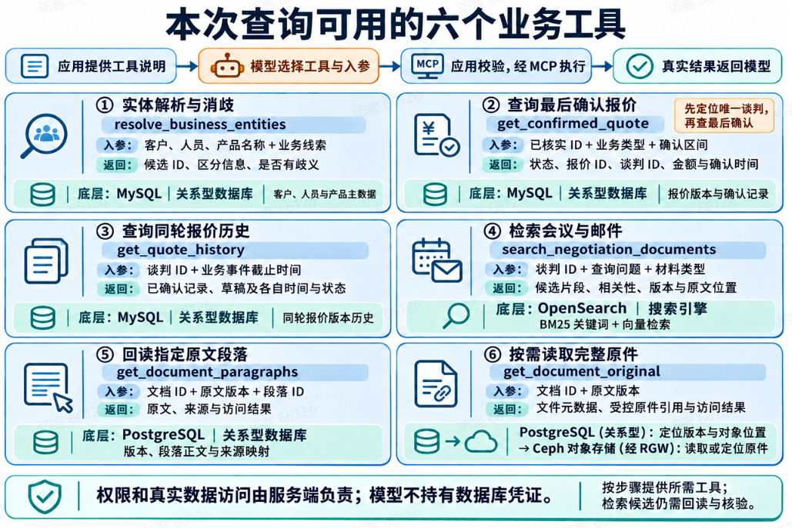

### Q1：上个月，张三给A客户做的企业协作平台年度续费报价，最后一次确认的金额是多少？

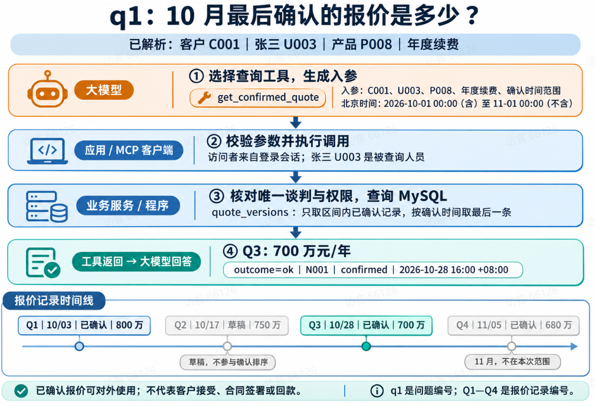

报价数据存储在 **MySQL 的 `quote_versions` 表**中，每条记录对应一个报价版本，保存其所属谈判、金额、状态及时间。后续调整新增版本，不覆盖此前的确认记录。这里“已确认”指报价流程中已经确认可对外使用的报价版本，不表示客户已接受、合同已签署或已经回款；旧版本保留的是历史确认事实，不代表当前仍然生效。下表为该表中 N001 报价记录的业务展示，金额按万元展示，“用途”列为记录作用的说明：

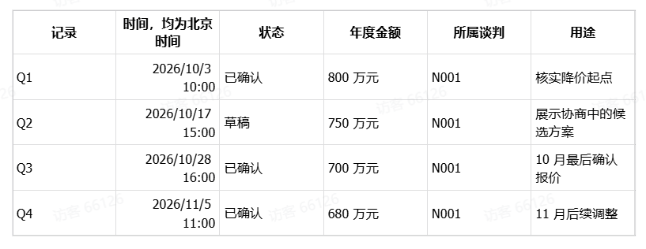

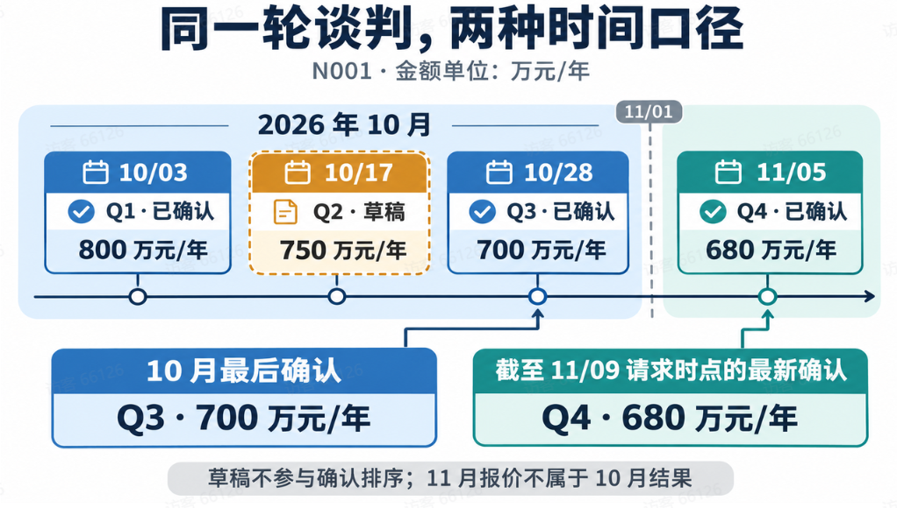

得到结论确实是700万元/年。

MySQL数据库查询的结果可作为证据保留。

大模型会选择

```json
{
  // 调用的工具：查询指定范围内的最后一条已确认报价
  "name": "get_confirmed_quote",

  // 传给工具的业务参数
  "arguments": {
    // A 客户的系统 ID，已通过主数据查询和消歧确认
    "customer_id": "C001",

    // 报价人员张三的 ID，不是当前查询者李经理的 ID
    "salesperson_id": "U003",

    // 企业协作平台的产品 ID
    "product_id": "P008",

    // 业务类型：年度续费
    "business_type": "annual_renewal",

    // 报价确认时间的起点：北京时间 10 月 1 日零点，包含该时刻
    "confirmed_from": "2026-10-01T00:00:00+08:00",

    // 报价确认时间的起点：北京时间 10 月 1 日零点，包含该时刻
    // 与起点组合，覆盖整个 2026 年 10 月
    "confirmed_to_exclusive": "2026-11-01T00:00:00+08:00"
  }
}
```

返回结果：

```json
{}
```

### Q2:同一轮谈判中，是否确实发生了年度报价从800万元调整到700万元的变化？

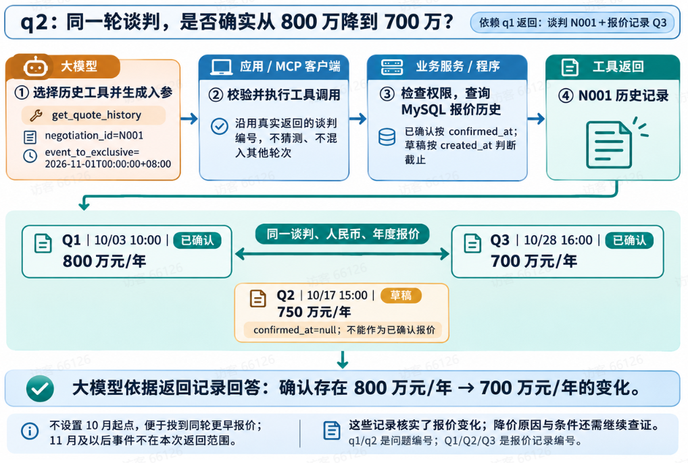

### Q3:如果确实发生降价，批准降价的原因和适用条件是什么？

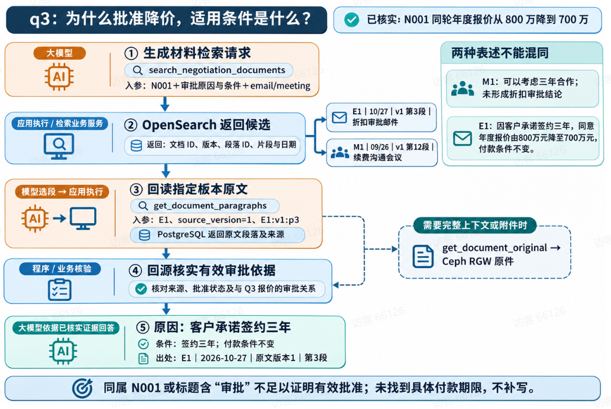

```json
{
  "outcome": "ok",
  "document_id": "E1",
  "source_version": 1,
  "paragraphs": [
    {
      "paragraph_id": "E1:v1:p3",
      "text": "因客户承诺签约三年，同意年度报价由800万元降至700万元，付款条件不变。"
    }
  ]
}
```

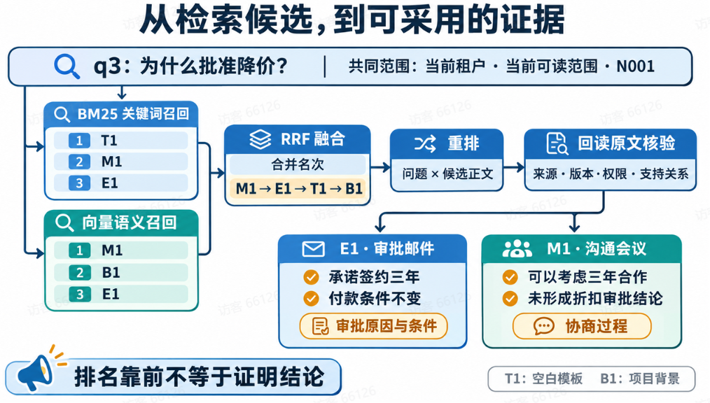

### Q4:与本轮谈判有关的会议有哪些，相关内容位于哪里？

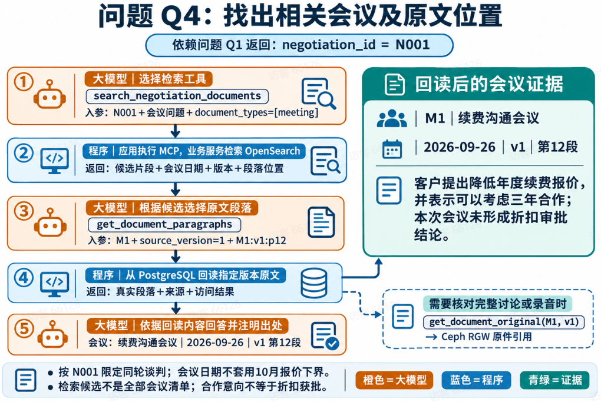

### Q5:与本轮谈判有关的邮件有哪些，相关内容位于哪里？

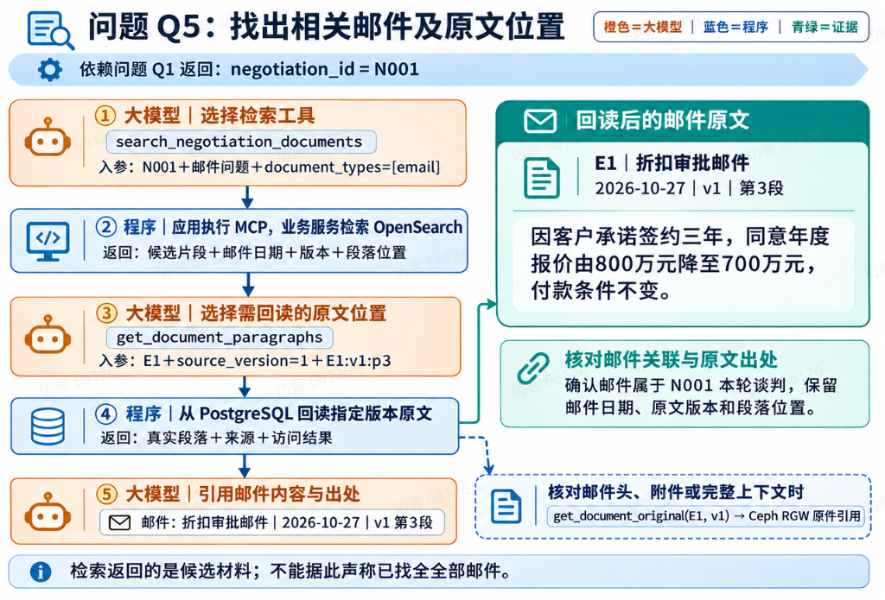

### 按需读取完整原件：Ceph RGW 的调用位置

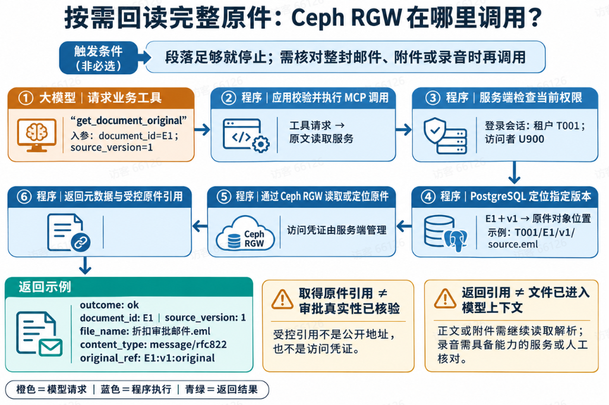

## 2.4 第四步：从markdown文档中获取规则

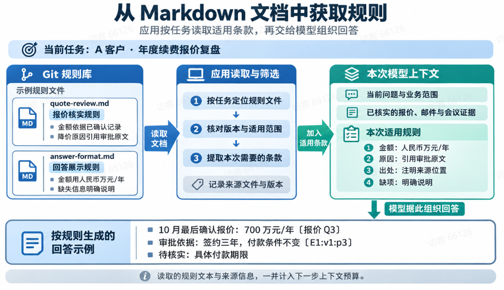

## 2.5 第五步：上下文预算管理

### 2.5.1 本次最终回答需要哪些上下文？

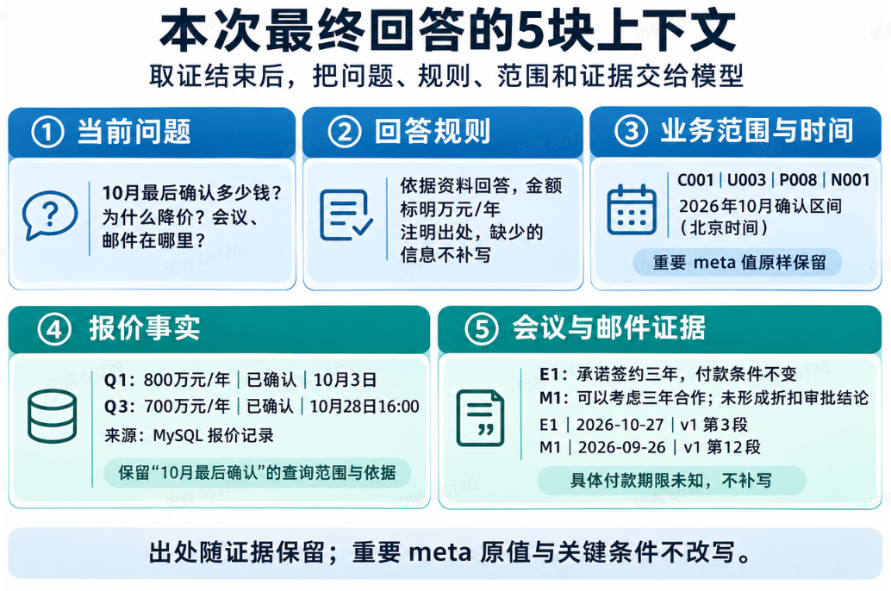

### 2.5.2 这5块拼起来，模型实际看到什么？

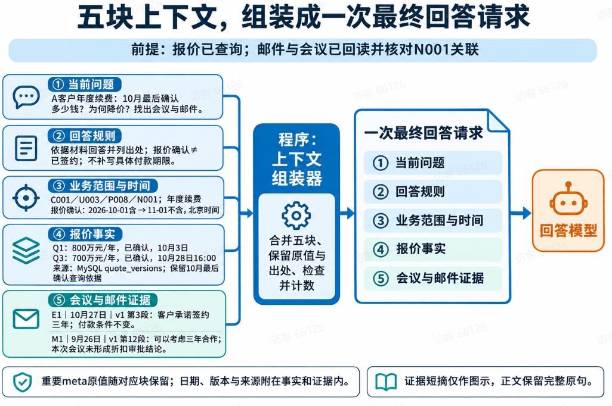

### 2.5.3 这5块内容怎样计入预算？

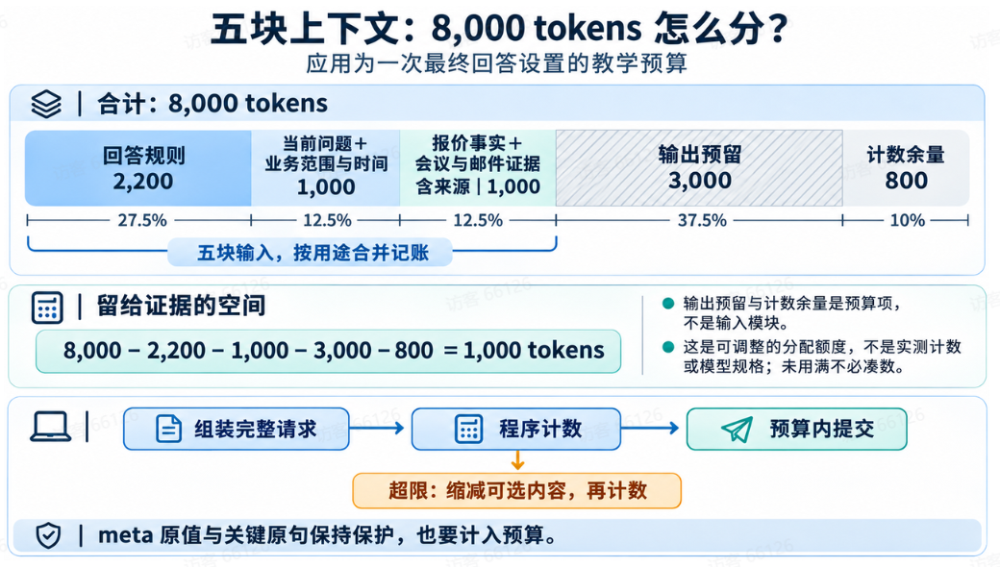

### 2.5.4 证据超过预算，具体删什么、保留什么？

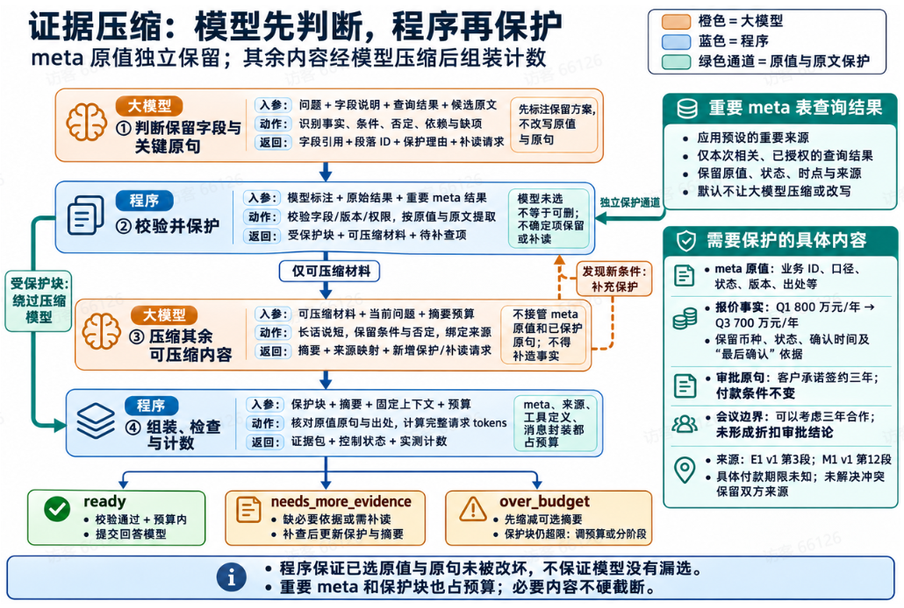
